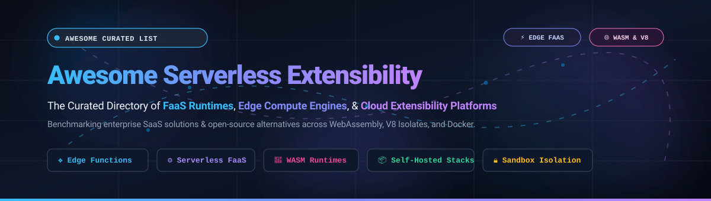

# ⚡ Awesome Serverless Extensibility

  

  
  
  
  
  
  
  
  

---

## 📖 Overview & Directory Scope

A curated directory and engineering landscape tracking top **SaaS platforms** ☁️, **edge runtimes** ⚡, and **open-source FaaS projects** 🛠️ for **Serverless Extensibility**. 

Serverless extensibility allows software architectures, SaaS platforms, and enterprise applications to execute custom business logic, event-driven workflows, and HTTP request mutations at the edge or in cloud isolation—without managing virtual machines or cluster nodes. It bridges the gap between turnkey SaaS apps and programmable infrastructure via WebAssembly (WASM), V8 sandboxes, containers, and serverless compute primitives.

### 🌟 Why Serverless Extensibility Matters
- ⚡ **Sub-5ms Execution Latency**: Moving compute to edge points of presence (PoPs) using V8 isolates and Wasmtime instead of heavyweight hypervisors.
- 📉 **Micro-Billing & Elasticity**: Instant scale-to-zero when idle, scaling up linearly to tens of thousands of requests per second.
- 🔒 **Tenant Isolation**: Secure execution of untrusted user code via WebAssembly sandbox barriers and isolated V8 memory heaps.
- 🔌 **Ecosystem Customization**: Extending commerce checkout hooks, API gateways, reverse proxies, and auth workflows programmatically.

---

## 📑 Table of Contents

- [📊 Sector Overview & Market Dynamics](#-sector-overview--market-dynamics)
- [☁️ SaaS & Hosted Extensibility Platforms](#️-saas--hosted-extensibility-platforms)
- [🛠️ Open-Source GitHub Projects](#️-open-source-github-projects)
  - [🏆 Top Open-Source Runtimes Ranked by Popularity](#-top-open-source-runtimes-ranked-by-popularity)
  - [💡 Architectural Highlights & Use Cases](#-architectural-highlights--use-cases)
- [🎯 Key Selection Criteria](#-key-selection-criteria)
- [🤝 How to Contribute](#-how-to-contribute)
- [💖 Support & Sponsorship](#-support--sponsorship)
- [📈 Star History](#-star-history)
- [⚖️ Disclaimer & License](#️-disclaimer--license)

---

## 📊 Sector Overview & Market Dynamics

The global serverless architecture and cloud extensibility market is estimated at **$21.3 billion in 2024–2025** and is projected to expand beyond **$65 billion by 2030 at a CAGR of ~22.7%**, driven by explosive enterprise adoption of edge computing, microservices, and AI inference pipelines 📈.

The market structure is **moderately concentrated among hyperscale cloud providers** (Amazon AWS, Microsoft Azure, Google Cloud) that control high-volume general compute, yet it exhibits **strong fragmentation and specialized multi-vendor growth at the edge layer**, where challengers like Cloudflare, Fastly, Vercel, Supabase, and Shopify capture high-margin niche workloads through superior developer experience (DX), sub-millisecond cold starts, and domain-tailored extensibility runtimes 🌐.

---

## ☁️ SaaS & Hosted Extensibility Platforms

The following SaaS and managed cloud providers provide turnkey serverless extensibility. Companies are sorted in **descending order by company scale** (market capitalization / enterprise valuation / ARR).

| Platform | Company Scale (Valuation / Market Cap) 🏢 | Starting Paid Pricing 💳 | Free Tier / Trial Limits 🎁 | Key Extensibility Strengths & Capabilities ⚙️ |
| :--- | :--- | :--- | :--- | :--- |
| **[Microsoft Azure Functions](https://azure.microsoft.com/en-us/products/functions)** | ~$3.1 Trillion Market Cap | $0.20 per 1M executions + $0.000016/GB-s (Flex Consumption starts at $0.017/vCPU-hr) | **1,000,000 requests/month free forever** + 400,000 GB-seconds resource consumption free per month; $200 Azure credit for 30-day initial trial | Deep integration with Azure Event Grid, Cosmos DB, and enterprise active directory; extensive polyglot language support (C#, Python, Java, Node.js). |
| **[AWS Lambda](https://aws.amazon.com/lambda/)** | ~$2.0 Trillion Market Cap *(Amazon parent)* | $0.20 per 1M requests ($0.0000166667 per GB-s for x86; $0.0000133334 per GB-s for Arm Graviton2) | **1,000,000 requests/month free forever** + 3,200,000 seconds of compute time per month (up to 400,000 GB-seconds); perpetual tier | The industry gold standard for general FaaS; triggers on S3, DynamoDB streams, Kinesis, SQS, API Gateway; supports snapstart microVMs. |
| **[Google Cloud Functions](https://cloud.google.com/functions)** | ~$2.0 Trillion Market Cap *(Alphabet parent)* | $0.40 per 1M invocations after free tier ($0.0000025/GB-s compute + $0.0000100/GHz-s) | **2,000,000 invocations/month free forever** + 400,000 GB-seconds, 200,000 GHz-seconds of compute, and 5 GB outbound networking per month | 2nd gen powered by Cloud Run and Knative; native integration with Cloud Pub/Sub, Cloud Storage, Firebase, and BigQuery streaming events. |
| **[Shopify Functions](https://shopify.dev/docs/api/functions)** | ~$115 Billion Market Cap | Included in Shopify plans starting at **$39/month** (Basic plan); custom checkout functions require Shopify Plus starting at **$2,300/month** | **3-day free trial** + promo rates ($1/month for initial months); all Shopify developer development stores are free indefinitely for building apps/functions | Wasm-based commerce logic executed in **under 5ms** directly inside Shopify core checkout, discounts, payment, and delivery routing pipelines. |
| **[Cloudflare Workers](https://workers.cloudflare.com/)** | ~$35 Billion Market Cap | **$5.00/month** paid plan (includes 10M requests/month + $0.30 per additional 1M requests + $0.02/GB-s) | **100,000 requests/day free forever** (max 10ms CPU time/request) + free Workers KV, D1 (5M rows read/day), and Vectorize testing quotas | V8 isolate architecture across 330+ edge locations globally; 0ms cold starts; integrated KV, D1 SQL, R2 storage, Hyperdrive, and Durable Objects. |
| **[Fastly Compute](https://www.fastly.com/products/compute)** | ~$1.2 Billion Market Cap | $50/month package after trial ($0.50 per 1M requests + $0.00002/GB-sec) | **$50/month free credit recurring indefinitely** to test services, plus 30-day initial developer trial without upfront commitment | WebAssembly-native edge compute running on Viceroy / Lucet / Wasmtime with sub-millisecond startup times and rigorous memory isolation. |
| **[Vercel Functions](https://vercel.com/docs/functions)** | ~$3.25 Billion Valuation *(Private)* | **$20/month per member** (Pro Plan); compute overages at $0.18 per 1M invocations + $0.00004/GB-s | **100 GB-hours/month free forever** (Hobby plan) + 1,000,000 edge/serverless requests per month; zero-cost personal tier | Best-in-class developer experience for Next.js, Nuxt, and frontend frameworks; seamless zero-config Git deployments and Edge Middleware. |
| **[Netlify Functions](https://docs.netlify.com/functions/overview/)** | ~$2.0 Billion Valuation *(Private)* | **$19/month per member** (Netlify Pro Plan); overage compute billed at $25 per 1M additional requests | **125,000 function requests/month free forever** + 100 hours of runtime per month on free tier | Intuitive Git-driven serverless workflow; scheduled cron functions, background asynchronous jobs, and edge functions powered by Deno. |
| **[Supabase Functions](https://supabase.com/docs/guides/functions)** | ~$500 Million Valuation *(Private)* | **$25/month** (Supabase Pro Plan); edge function invocations billed at $2 per 1M additional invocations | **500,000 edge function invocations/month free forever** across 2 active projects on the Free Plan | Deno-powered TypeScript functions running globally at the edge; native direct access to PostgreSQL database, Row Level Security, and Supabase Auth. |

---

## 🛠️ Open-Source GitHub Projects

Self-hosted and open-source serverless runtimes offer complete data sovereignty, zero vendor lock-in, on-premises deployment compliance, and zero-cost local iteration.

### 🏆 Top Open-Source Runtimes Ranked by Popularity

The table below lists leading open-source serverless frameworks, runtimes, and extensibility engines sorted in **descending order by GitHub star count**.

| Project | GitHub Stars ⭐ | Primary Language / Runtime 💻 | Architecture & Description 📌 |
| :--- | :---: | :--- | :--- |
| **[Serverless Framework](https://github.com/serverless/serverless)** |  | JavaScript / Node.js / Multi | The ubiquitous developer CLI and deployment framework for building, packaging, and managing serverless applications across AWS Lambda, Azure, and Google Cloud. |
| **[OpenFaaS](https://github.com/openfaas/faas)** |  | Go / Kubernetes / Docker | Enterprise-grade, Kubernetes-native FaaS that turns any container into a serverless function with built-in Prometheus auto-scaling and event gateway connectors. |
| **[workerd](https://github.com/cloudflare/workerd)** |  | C++ / V8 Isolates / WASM | The actual open-source JavaScript/Wasm runtime that powers Cloudflare Workers; engineered for ultra-fast startup, high concurrency, and secure process sandboxing. |
| **[Fission](https://github.com/fission/fission)** |  | Go / Kubernetes | Fast, open-source serverless framework for Kubernetes focused on developer productivity with warm-container pools enabling sub-100ms cold starts. |
| **[Apache OpenWhisk](https://github.com/apache/openwhisk)** |  | Scala / Docker / Kubernetes | Robust distributed serverless execution engine powering event-driven business logic at scale; original foundation for IBM Cloud Functions. |
| **[Fermyon Spin](https://github.com/spinframework/spin)** |  | Rust / WebAssembly (Wasmtime) | Open-source developer tool and micro-engine for building and running lightning-fast serverless applications powered by WebAssembly Component Model standards. |
| **[Fn Project](https://github.com/fnproject/fn)** |  | Go / Docker-native | Container-native, cloud-agnostic serverless FaaS platform created by Oracle; runs on any cloud or bare metal cluster with native Docker container execution. |
| **[Nuclio](https://github.com/nuclio/nuclio)** |  | Go / Multi-runtime / GPU | High-performance serverless event and data processing platform capable of 400,000+ function invocations/sec; optimized for real-time telemetry, AI/ML, and GPU pipelines. |
| **[Juno](https://github.com/junobuild/juno)** |  | Rust / TypeScript / WASM | Open-source serverless platform combining static hosting, functions, auth, and datastores into an all-in-one self-hostable Vercel + Firebase alternative. |
| **[Own FaaS](https://github.com/ihidzhov/FaaS)** |  | PHP / SQLite | Lightweight, minimalist self-hosted FaaS engine written in PHP with an embedded SQLite datastore, cron/HTTP triggers, and a browser-based function code editor. |
| **[fn0](https://github.com/NamseEnt/fn0)** |  | Rust / V8 / Wasmtime | Clean-room open-source FaaS alternative to Fermyon Spin and Cloudflare Workers, running WASI 0.3 components and V8 JavaScript isolates with integrated S3 & doc store. |
| **[localworker](https://github.com/oldfriendme/localworker)** |  | Go / Rust / workerd | Lightweight self-hosted Cloudflare Worker runner packaging a Web IDE with Cloudflare's core `workerd` runtime for unrestricted local testing and private VPS hosting. |

---

### 💡 Architectural Highlights & Use Cases

- ⚡ **For Cloudflare Workers drop-in compatibility**: Use [`cloudflare/workerd`](https://github.com/cloudflare/workerd) for pure low-level runtime parity or [`oldfriendme/localworker`](https://github.com/oldfriendme/localworker) for zero-configuration VPS and local developer testing.
- 🦀 **For WebAssembly (WASM) Component Model native execution**: Choose [`spinframework/spin`](https://github.com/spinframework/spin) or [`NamseEnt/fn0`](https://github.com/NamseEnt/fn0) for instant microsecond startups, compact binary distribution, and memory-safe sandboxing.
- ☸️ **For Kubernetes-native production clusters**: Deploy [`openfaas/faas`](https://github.com/openfaas/faas) or [`fission/fission`](https://github.com/fission/fission) to execute polyglot microservices without cloud provider lock-in.
- 🚀 **For Data Science, Stream Processing, & GPU acceleration**: Run [`nuclio/nuclio`](https://github.com/nuclio/nuclio) to achieve high throughput and low-latency processing over Kafka, Kinesis, and MQTT streams.
- 🐳 **For Docker-first portability**: Pick [`fnproject/fn`](https://github.com/fnproject/fn), allowing any Docker image to execute as a serverless function across hybrid clouds.
- 📦 **For Full-stack BaaS + Serverless functions**: Adopt [`junobuild/juno`](https://github.com/junobuild/juno) for combined frontend hosting, storage, authentication, and execution with self-hosting autonomy.

---

## 🎯 Key Selection Criteria

When choosing a serverless extensibility runtime or platform for production systems, evaluate across these dimensions:

1. ⏱️ **Cold Start Penalty**:
   - V8 Isolates (`workerd`, Cloudflare Workers): `< 5ms`
   - WebAssembly Modules (`Spin`, Fastly Compute): `< 1ms`
   - Containerized FaaS (`AWS Lambda`, `OpenFaaS`): `50ms – 800ms` (dependent on language runtime and package size)
2. 🛡️ **Execution Sandboxing & Multi-tenancy**:
   - Evaluate whether third parties or customers will be uploading arbitrary scripts. Wasmtime and V8 isolates provide hardware-efficient isolation boundaries without requiring a full virtual machine per function invocation.
3. 🔗 **Trigger Ecosystem**:
   - Verify native bindings for queues (SQS, Kafka, RabbitMQ), blob storage (S3, R2, GCS), relational/vector databases, and HTTP webhooks.
4. 📍 **Data Locality & Edge State**:
   - Ensure the runtime provides co-located KV caches, durable object state, or edge-replicated databases to prevent latency degradation when fetching remote state.

---

## 🤝 How to Contribute

Contributions, bug reports, and suggestions are welcome! Help expand this serverless extensibility reference:

1. 🍴 **Fork the repository** to your personal GitHub account.
2. 🌿 **Create a branch** for your feature or additions (`git checkout -b feature/add-new-faas-platform`).
3. 📝 Add your entry following the established table formats:
   - Provide verified starting paid pricing and specific free-tier limits.
   - For open-source projects, specify the GitHub repo link and ensure the social star badge is included.
4. 🎯 Keep commentary strictly objective, engineering-focused, and factual.
5. 🚀 **Open a Pull Request** with a concise summary of changes and official documentation references.

---

## 💖 Support & Sponsorship

Thank you so much for exploring and using **Awesome Serverless Extensibility**! 🙌

If you found this curated list helpful for your project, architecture design, or evaluation of serverless runtimes, please consider:
- ⭐ **Starring this repository** to show your support and help others discover it.
- 🍴 **Forking and sharing** it with your fellow engineers, platform teams, and community.
- ☕ **Buying a coffee & sponsoring ongoing maintenance**: Support development directly via the [GitHub Sponsor Dashboard](https://github.com/sponsors/ishandutta2007).

Your support keeps this directory updated with the latest FaaS runtimes, edge compute innovations, and enterprise benchmarks! 🚀

---

##  Star History

---

## ⚖️ Disclaimer & License

- This repository is a community-maintained curated knowledge base. All company names, logos, and registered trademarks belong to their respective owners.
- Performance characteristics (cold start speeds, pricing tiers, and quotas) are subject to change by vendors; always refer to official documentation before making production architecture commitments.
- Released under the [MIT License](file:///C:/Users/hp/Documents/Projects/Awesome-Serverless-Extensibility/LICENSE).
